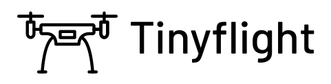
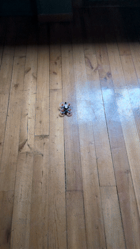
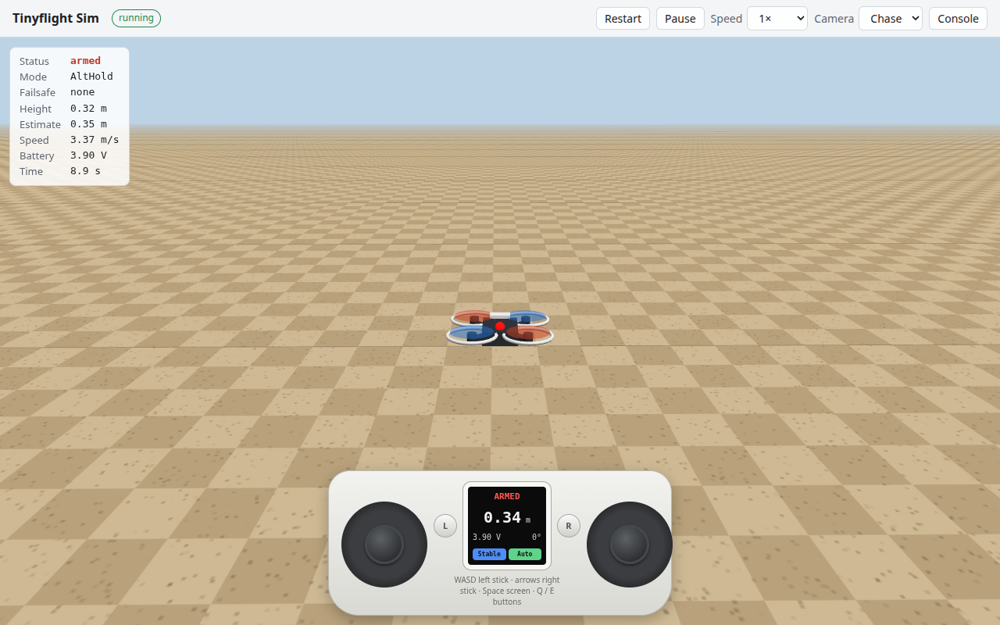
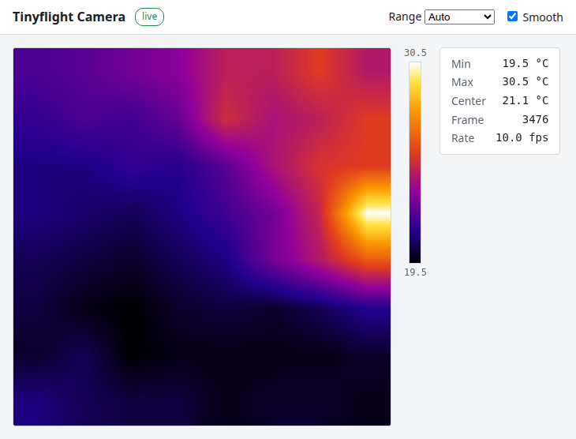

# Tinyflight

[](https://github.com/hybridgroup/tinyflight/actions/workflows/ci.yml) [](https://github.com/hybridgroup/tinyflight/actions/workflows/ci.yml)

Flight control firmware written in Go and built with [TinyGo](https://tinygo.org). Supports the [M5Stack StampFly](https://docs.m5stack.com/en/app/StampFly_v1.1) and is 100% protocol compatible with the [M5Stack Atom Joystick](https://docs.m5stack.com/en/app/Atom_JoyStick).



## Quick install

Just want to run TinyFlight on your drone right now? You can download the pre-built BIN file from our [releases](https://github.com/hybridgroup/tinyflight/releases), and flash it on your m5-stampfly using [espflasher](https://github.com/tinygo-org/espflasher) or esptool.

```
espflasher -port /dev/ttyACM0 stampfly.bin
```

or

```
esptool --port /dev/ttyACM0 write-flash 0x0000 stampfly.bin
```

## Features

- Flight modes: Acrobatic, Stabilized, Altitude Hold, and <b>Position Hold</b>
- Fly with the M5 Atom Joystick over ESP-NOW, using its stock firmware
- Arming checks, plus failsafes for lost pilot input, low battery, lost height, crashes and IMU failure
- Pure Go flight stack with full set of tests, including closed loop tests on a simulated quad
- tinyflightsim, a browser flight sim that runs the real firmware as WebAssembly, flown with an on-screen Atom Joystick
- Live images from an optional AMG8833 thermal camera, sent over ESP-NOW and shown in the browser
- Bench control with text lines over USB serial
- Optional blackbox flight log saved to flash

## How it works

- 400 Hz flight loop with no heap memory allocations after startup
- Supports multicore on the ESP32-S3, where the flight loop gets a core to itself
- Attitude estimation using Mahony filters
- Height and position estimates from Kalman filters using the barometer, ToF distance sensor and optical flow
- Cascaded position, attitude and rate controllers

See [docs/architecture.md](docs/architecture.md) for architectural details. See [docs/protocol.md](docs/protocol.md) for the radio protocol used with the M5 Atom Joystick. See [docs/joystick.md](docs/joystick.md) for how to fly with it. See [docs/simulator.md](docs/simulator.md) for the browser sim. See [docs/camera.md](docs/camera.md) for streaming images from an optional thermal camera.

## tinyflightsim

Fly the real firmware in a web browser before you fly the drone. Try it at https://tinyflight.app/ or see [docs/simulator.md](docs/simulator.md).



## Cameras

Stream live images from an optional AMG8833 thermal camera while you fly, and watch them in the browser with `tools/cameraview`. See [docs/camera.md](docs/camera.md).



## Layout

```
pkg/      flight stack written in pure Go with unit tests
devices/  adapters from TinyGo drivers to pkg/hal
boards/   board setup, such as boards/stampfly, and boards/sim for the browser sim
firmware/ firmware and bench tools to flash
tools/    host tools, such as the tinyflightsim browser sim and the cameraview image viewer
docs/     documentation
```

## Running the tests

```
go test ./...
```

This includes closed loop tests that fly a simulated quad.

## Building for the StampFly

TinyGo needs to use the cores scheduler to use both cores on the ESP32S3. This ensures that the flight loop gets a core to itself:

```
tinygo flash -scheduler=cores -target m5stamp-fly ./firmware/stampfly-sensors
tinygo flash -scheduler=cores -target m5stamp-fly ./firmware/stampfly-motortest
tinygo flash -scheduler=cores -target m5stamp-fly ./firmware/stampfly
tinygo flash -scheduler=cores -target m5stamp-fly ./firmware/stampfly-camera
tinygo flash -scheduler=cores -target m5stamp-fly ./firmware/stampfly-cameratest
tinygo flash -scheduler=cores -target m5stamp-fly ./firmware/stampfly-channelscan
```

### Height limit

In AltHold and PosHold the StampFly will not climb past 10 m above where it took off. Set a different limit in meters with `-ldflags`, or 0 for no limit:

```
tinygo flash -scheduler=cores -target m5stamp-fly -ldflags="-X github.com/hybridgroup/tinyflight/boards/stampfly.MaxHeight=2" ./firmware/stampfly
```

### Radio channel

The StampFly and joystick talk on Wi-Fi channel 3 by default. In a crowded place such as a conference, run [`stampfly-channelscan`](firmware/stampfly-channelscan/README.md) to find a quieter channel. Then set it with `-ldflags` and pair the joystick again, since it saves the channel when it pairs:

```
tinygo flash -scheduler=cores -target m5stamp-fly -ldflags="-X github.com/hybridgroup/tinyflight/devices/espnowinput.ChannelSetting=13" ./firmware/stampfly
```

Flash the camera receiver with the same setting.

### Firmware

| Firmware | What it does |
|---|---|
| [`stampfly-sensors`](firmware/stampfly-sensors/README.md) | Prints every sensor, the attitude, loop timing and heap use. The motors stay off. |
| [`stampfly-motortest`](firmware/stampfly-motortest/README.md) | Spins each motor in turn when you press the button. Remove the propellers first. |
| [`stampfly`](firmware/stampfly/README.md) | The flight firmware. For bench tests, send lines over USB serial in the form `rc roll pitch yaw throttle arm mode`. Mode is 0 for acro, 1 for stabilize, 2 for althold and 3 for poshold. Built with `-tags blackbox`, it saves the last 5 flights to flash and prints the latest over USB every 10 s while disarmed. See [docs/joystick.md](docs/joystick.md#reading-the-flight-log). |
| [`stampfly-camera`](firmware/stampfly-camera/README.md) | The flight firmware plus an AMG88xx thermal camera on the Grove port. It streams frames over ESP-NOW. See [docs/camera.md](docs/camera.md). |
| [`stampfly-cameratest`](firmware/stampfly-cameratest/README.md) | Bench tool for the thermal camera. The motors stay off and frames go over USB to `tools/cameraview`. See [docs/camera.md](docs/camera.md#testing-on-the-bench). |
| [`stampfly-channelscan`](firmware/stampfly-channelscan/README.md) | Counts the Wi-Fi traffic on each channel and prints the quietest one to fly on. The motors stay off. |
| [`camera-receiver`](firmware/camera-receiver/README.md) | For an ESP32-C3 on the computer, not the StampFly. Prints camera frames heard over ESP-NOW for `tools/cameraview`, and shows them on an SSD1306 display if one is attached. See [docs/camera.md](docs/camera.md). |
