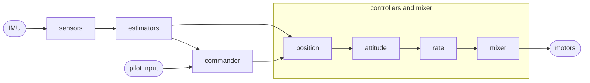
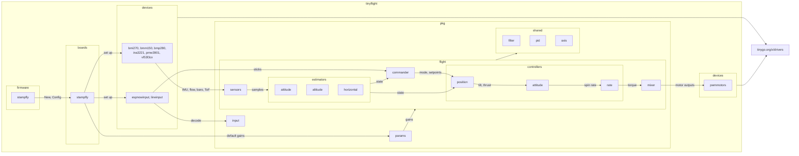
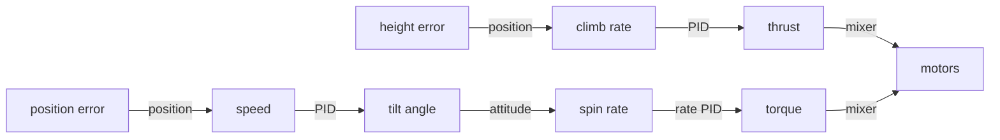

# Tinyflight architecture

Tinyflight is flight control firmware written in Go and built with TinyGo. This page explains how it works without assuming you know control theory.

The design is influenced by the [PX4 multicopter controller](https://docs.px4.io/main/en/flight_stack/controller_diagrams.html). Each job lives in its own small package, and each package only talks to the next one through plain data structs.

## The big picture

A quadcopter can't hover by itself. Hundreds of times a second, the flight controller has to work out which way the vehicle is pointing, compare that with what the pilot wants, and change the speed of each motor to correct the difference. Tinyflight does this 400 times per second in one loop:

1. **Sensors** read the IMU and clean up the numbers.
2. **Estimators** work out the vehicle's orientation, height and position.
3. **Commander** decides if the motors may run and which flight mode is active.
4. **Controllers** turn "where I want to be" into "how hard to push".
5. **Mixer** splits that push into one speed per motor.

## Coordinate frames and units

Everything uses SI units: metres, seconds, radians, m/s². Like PX4:

- **Body frame** is FRD. X points forward, Y right, Z down.
- **Earth frame** is NED. X points north, Y east, Z down.

Z points down, so height above the takeoff point is a negative Z. A positive roll tips the right side down, a positive pitch raises the nose, and a positive yaw turns right.

## Packages

All the flight logic lives under `pkg/`. None of it imports hardware packages, so all of it runs and is tested with plain `go test` on a PC.

| Package | What it does |
|---|---|
| `pkg/fmath` | Vectors and quaternions in float32. A quaternion is a compact way to store a 3D orientation. Trig comes from [tinymath](https://github.com/orsinium-labs/tinymath), good to about 0.003 rad. |
| `pkg/msg` | The data structs passed between stages. |
| `pkg/hal` | Interfaces a board has to provide, such as `IMU`, `Baro` and `Motors`. |
| `pkg/filter` | Low-pass filters that remove fast jitter, and notch filters that remove one specific vibration frequency. |
| `pkg/sensors` | Turns the chip's axes into body axes, measures gyro bias while sitting still on the ground, filters noise, and turns optical flow counts into rates. |
| `pkg/estimator/attitude` | Works out orientation. The gyro is accurate over short times but drifts, while gravity seen by the accelerometer is noisy but never drifts. This filter (Mahony) trusts the gyro moment to moment and slowly pulls toward gravity. |
| `pkg/estimator/altitude` | A small Kalman filter for height and climb rate. Vertical acceleration predicts the next value, then the barometer and the downward distance sensor correct it. A Kalman filter is a way to blend predictions and measurements based on how much each one can be trusted. |
| `pkg/estimator/horizontal` | Another small Kalman filter, for north and east position and speed. The optical flow sensor sees the ground slide by. Taking out the part caused by turning and multiplying by the height gives the speed. |
| `pkg/estimator/axis` | The Kalman filter for position, speed and accel bias along one axis that the altitude and horizontal filters share. |
| `pkg/control/pid` | A PID controller. It pushes harder the bigger the error (P), the longer the error lasts (I), and the faster it changes (D). |
| `pkg/control/rate` | The innermost loop. It turns a spin rate setpoint into a torque. |
| `pkg/control/attitude` | Turns an orientation setpoint into spin rates for the rate loop. |
| `pkg/control/position` | Height and position hold. Turns a height error into a climb rate, then a climb rate error into thrust. Turns a position error into a speed, then a speed error into a tilt. |
| `pkg/mixer` | Splits thrust and torque into one command per motor. If the motors can't do everything asked, keeping level wins over thrust, and thrust wins over yaw. |
| `pkg/commander` | Arming checks, flight modes and failsafes. |
| `pkg/input` | Decodes pilot input, both from the M5 Atom Joystick and from text lines on USB serial. |
| `pkg/params` | Every gain and limit in one struct. |
| `pkg/flight` | Connects all the stages and runs them at a fixed rate. |
| `pkg/sim` | A physics model of a small quad with fake sensors, used for closed loop tests. |

Hardware specific code lives outside `pkg/`:

| Path | What it does |
|---|---|
| `devices/` | Adapters from the TinyGo drivers to the `pkg/hal` interfaces. Any board with the same chips can reuse them. |
| `boards/stampfly` | Pins, sensor setup, IMU axis rotation, motor order and default gains for the M5Stack StampFly. |
| `firmware/` | Programs you flash: the flight firmware and bench tools. |
| `tools/estimate` | Host-only checks against [go-estimate](https://github.com/milosgajdos/go-estimate). It has its own `go.mod`, so gonum never gets into the firmware. |

## How the packages connect

This shows the major parts of the StampFly flight firmware and how they fit together. Arrow labels show the data that moves between them. Every arrow between `devices` and `flight` goes through a `pkg/hal` interface. `pkg/fmath` and `pkg/msg` are used almost everywhere, so they are left out.

## Why the controllers come in a chain

Each loop in the chain controls something that's faster and easier than the loop above it:

The rate loop only has to make the vehicle spin at a chosen speed. That's quick and direct, because motor torque changes spin rate right away. The attitude loop then only has to choose a spin rate that turns the vehicle toward the wanted angle. Splitting the problem this way keeps each part simple and easy to tune one at a time: tune rate first, then attitude, then height, then position.

## Flight modes

| Mode | Sticks control | Use |
|---|---|---|
| Acro | spin rate | Flips and fast flying. The vehicle doesn't level itself. |
| Stabilize | tilt angle, throttle sets thrust | Normal flying. Letting go of the sticks levels the vehicle. |
| AltHold | tilt angle, throttle stick sets climb rate | Like Stabilize, but holds height when the stick is centred. |
| PosHold | speed, throttle stick sets climb rate | Like AltHold, but also holds its spot over the ground when the sticks are centred. It needs the optical flow sensor and the downward distance sensor. Above about 2 m, below 8 cm, or over a surface with no texture, it flies like AltHold. |

## Safety

The commander only arms when:

- the gyro is calibrated,
- pilot input is fresh,
- the throttle is low,
- the vehicle is close to level,
- the battery is not low.

| Problem | What happens |
|---|---|
| Pilot input lost for 0.5 s | Level out and descend, then disarm |
| Battery low for 2 s | Level out and descend, then disarm |
| Tilt past about 70° in any mode but Acro | Stop motors at once, as it is probably a crash |
| IMU stops answering | Stop motors |

## Timing

The flight loop runs at a fixed rate and reads the IMU on every pass.

On a dual core chip like the ESP32-S3, built with `-scheduler=cores`, the two cores split the work:

| Core | Runs |
|---|---|
| 1 | Only the flight loop: IMU and optical flow over SPI, estimators, controllers and motors. It waits for the next pass by watching the clock instead of sleeping, so nothing else can delay it. |
| 0 | Interrupts, the radio, the slower I2C sensors (barometer, distance sensor, magnetometer, battery) and status printing. |

`RunSensors` reads the slow sensors on core 0. It hands each new reading to the flight loop through a small locked mailbox, and the loop picks it up on its next pass. The ToF sensor alone takes about 5 ms per reading, which is two whole loop passes, so keeping it off core 1 matters.

On a single core, or in the simulator, the loop reads at most one slow sensor per pass instead, so no single pass takes too long.

`flight.Stats` records overruns, jitter and the slowest pass. The flight loop never allocates memory after startup. `TestStepDoesNotAllocate` checks this, because a garbage collection pause in the middle of flight would cause a twitch.

## Filters and go-estimate

The on-board filters are written by hand in float32 with fixed-size arrays. The ESP32-S3 only has hardware float32 support, so Tinyflight uses no float64 at all: every float64 operation runs in software and is many times slower. The flight loop must also not allocate. go-estimate is a general Kalman filter library built on gonum and float64, which makes it too heavy for the microcontroller. `tools/estimate` uses it on the PC to check that the on-board altitude filter gives the same answers as a reference implementation.

## Adding a new board

1. Write adapters in `devices/` for any chips that don't have one yet.
2. Add `boards/<name>`. It should set up the buses, return a `flight.Hardware`, and return a `params.Config` with the right IMU rotation, mixer geometry and gains.
3. Add `firmware/<name>` with a short `main` that calls the board package and `flight.Run`.

Nothing under `pkg/` should need to change.
