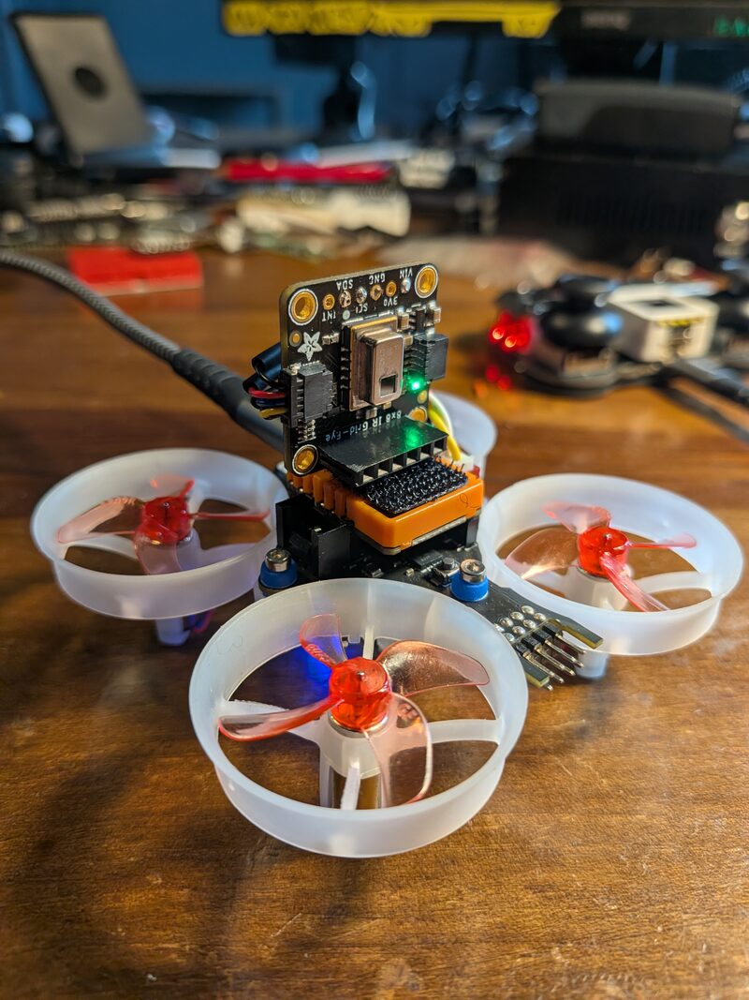

# Thermal camera

Tinyflight can stream low resolution images from an optional AMG8833 thermal sensor while you fly with the M5 Atom Joystick. The drone sends each frame over ESP-NOW. A second ESP32-C3 board plugged into the computer hears them, and `tools/cameraview` shows them live in the browser.

```
AMG8833 --Grove I2C--> StampFly --ESP-NOW--> ESP32-C3 --USB serial--> cameraview --> browser
                          ^
                          |  ESP-NOW
                     Atom Joystick
```



The AMG8833 gives 8 by 8 pixels from 0 to 80 °C at 10 frames per second. The packet and viewer are not tied to it, so a better camera can use them later. See [protocol.md](protocol.md#camera-packet-drone-to-ground-receiver).

## What you need

- An AMG8833 breakout, such as the Adafruit board.
- A small 3.3 V regulator that runs from 5 V, such as a Pololu D24V5F3 or an MCP1700-3302E with a 1 µF capacitor on each side. The sensor draws only a few mA.
- An ESP32-C3 board, such as a Seeed XIAO ESP32-C3. A computer cannot hear ESP-NOW on its own.

## Wiring

The sensor goes on the StampFly Grove port. It has its own I2C bus on GPIO13 SDA and GPIO15 SCL, so the camera never shares a bus with the flight sensors.

The Grove port gives 5 V, with 4.7 kΩ pull-ups on SDA and SCL to 3.3 V, from J3 in the StampFly schematic. The Adafruit board pulls SDA and SCL up to its Vin, so with Vin on 5 V the lines would sit near 3.8 V. That is over the 3.6 V limit of the ESP32-S3 pins, from section 5.1 of the ESP32-S3 datasheet. A regulator puts Vin on 3.3 V instead.

| From | To |
|---|---|
| Grove red, 5 V | Regulator IN |
| Grove black, GND | Regulator GND and Adafruit GND |
| Regulator OUT, 3.3 V | Adafruit Vin |
| Grove yellow, SCL | Adafruit SCL |
| Grove white, SDA | Adafruit SDA |

Before connecting SDA and SCL to the StampFly, power it up and check that regulator OUT and the Adafruit SDA and SCL pins all read about 3.3 V.

### Direct cable

A Grove to Qwiic or STEMMA QT cable plugs straight into the Adafruit board with no regulator. It is simpler and lighter, but the cable passes the Grove 5 V to Vin, so SDA and SCL may sit over the 3.6 V limit. It works, but it can wear out the ESP32-S3 I2C pins over time. Check SDA and SCL to GND with a meter while it is powered, and use the regulator wiring if they read over 3.6 V.

At power on the firmware looks for the sensor at I2C address 0x69, then 0x68. If it finds one, it prints `camera found` over USB. If not, it prints `no camera` and flies without it.

## Mounting

- Point the sensor forward or down and fix it so it cannot touch a propeller.
- Keep it light. The StampFly weighs about 37 g, so every gram cuts the spare thrust. A 9 g add-on needed about 0.70 thrust to hover on a sagging battery and could barely climb. The 5 g setup in the photo flies well.
- Keep the weight over the middle. With the camera forward of center the nose dropped about 9° at liftoff and the drone shot forward. Balance it on a fingertip under the middle to check.
- Fly on a full battery and land early, since a heavier drone runs out of thrust sooner as the voltage sags.
- Route the wires away from the ESP32-S3 antenna. With them close, each radio send put a stripe of cold pixels in most frames, and moving them cut that from 69% of frames to about 5%.

## Flashing

The drone needs the camera flight firmware. It flies like `firmware/stampfly` and also sends the frames. See the [README](../README.md#building-for-the-stampfly).

```
tinygo flash -scheduler=cores -target m5stamp-fly ./firmware/stampfly-camera
```

Then flash the receiver onto the ESP32-C3. For another ESP32-C3 board, use its TinyGo target.

```
tinygo flash -target xiao-esp32c3 ./firmware/camera-receiver
```

## Viewing

Plug the receiver into the computer and run

```
cd tools/cameraview
go run . -port /dev/ttyACM0
```

Then open http://localhost:8081. On macOS the port looks like `/dev/cu.usbmodem1101`, and on Windows like `COM3`.


The page shows the image, the coldest, hottest and center temperatures, and the frame rate. Hover over the image to read any spot. Range picks the color scale, and Smooth blends between the 8 by 8 pixels. Auto keeps the scale at least 8 °C wide, so an empty scene stays calm instead of showing the sensor noise. Flip vertical and Flip horizontal match how the camera is mounted, and the browser remembers them. Check both to turn the image upside down.

## Display on the receiver

The receiver can also show the image on a 128 by 64 SSD1306 OLED, so you can watch it away from the computer. The display is optional. One that works is the Seeed Studio XIAO expansion board with the XIAO ESP32-C3 plugged into it.

Any SSD1306 at I2C address 0x3C or 0x3D on the board's default I2C pins works, which are D4 SDA and D5 SCL on the XIAO. The M5Stack M5StampS3 uses GPIO13 SDA and GPIO14 SCL with `-target m5stamp-s3a`. The `m5stamp-c3` target has no I2C in TinyGo, so it runs without the display.

At power on the receiver prints `display found` over USB if it finds one, and the display shows `waiting` until the first frame. Then the left half shows the image with hot areas lit, and the right half shows the hottest, center and coldest temperatures in °C. The scale stays at least 8 °C wide, like Auto in the viewer. The receiver still prints every frame over USB, so the viewer works at the same time.

## Testing on the bench

To check the camera without flying, flash the bench firmware. It keeps the motors off, does not use the radio, and prints the frames over USB itself, so you need no joystick or receiver.

```
tinygo flash -scheduler=cores -target m5stamp-fly ./firmware/stampfly-cameratest
```

Leave the StampFly plugged in and point the viewer at its port.

```
cd tools/cameraview
go run . -port /dev/ttyACM0
```

Then open http://localhost:8081. A hand in front of the sensor shows as a warm spot. If the sensor is not found, the StampFly prints `no camera` every few seconds.

## How it works

- The drone reads the sensor every 100 ms on core 0. The flight loop on core 1 is not touched.
- The sensor averages each pixel over two frames, from the AVE register in the Grid-EYE datasheet. On the bench this cut the noise from 0.40 °C to 0.27 °C per pixel.
- Frames are only sent once the joystick has paired, since the joystick checks every packet while pairing. After that it ignores camera packets.
- Each frame is one 139 byte broadcast, about 1.4 kB/s. The `cam_sent` and `cam_failed` counts in the USB printout show how many went out.
- The receiver only listens and never sends.
- The receiver prints each frame as a line `cam seq format width height chunk chunks count pixels... sum`. The viewer drops any line where the sum does not match.
