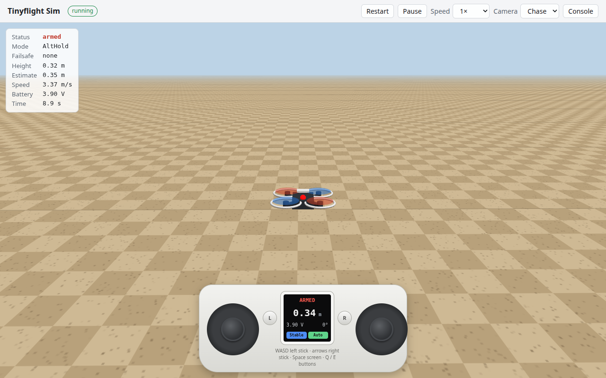
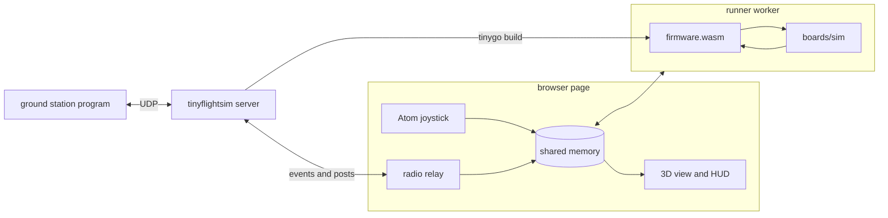

# Flying in the browser sim

`tools/tinyflightsim` flies the real Tinyflight firmware in a web browser. It builds `firmware/stampfly` with TinyGo to WebAssembly and runs it against a physics model of the StampFly. You fly it with an on-screen copy of the M5 Atom Joystick, the keyboard, a gamepad or a joystick, or from a ground station program.



## Running it

The newest build from main runs at https://tinyflight.app/. `.github/workflows/pages.yml` builds the firmware and copies the page there on every push to main. GitHub Pages cannot set the cross origin isolation headers, so the page loads `coi-serviceworker.js`, which adds them and reloads the page once.

To run it yourself with your own changes:

You need Go and TinyGo. The sim build does not need the drivers checkout from the README.

```
cd tools/tinyflightsim
go run .
```

Then open http://localhost:8080.

The server builds the firmware the first time the page asks for it, which takes a few seconds. Builds are cached on a hash of the Go sources. After you change the firmware or a setting such as a gain in `boards/stampfly/config.go`, press **Restart** to rebuild and power cycle the drone.

| Flag | Default | What it does |
|---|---|---|
| `-addr` | `localhost:8080` | Address to serve the page on, and to take ground station packets on over UDP |
| `-repo` | `../..` | Root of the tinyflight module |
| `-tinygo` | `tinygo` | TinyGo command |
| `-firmware` | `./firmware/stampfly` | Firmware package to build |

To build with the newest TinyGo, run the server in the TinyGo dev container from the root of the repo. Git in the container does not trust the mounted checkout, so turn off VCS stamping:

```
docker run --rm -it -p 8080:8080 -e GOFLAGS=-buildvcs=false -v $(pwd):/src -w /src/tools/tinyflightsim tinygo/tinygo-dev:latest go run . -addr :8080
```

## Controls

The joystick works like the real one with the stock StampFlyController firmware. See [joystick.md](joystick.md) for the full details.

| Joystick | Keyboard | Gamepad | Setup screen | Running screen |
|---|---|---|---|---|
| Screen | Space | A | Go to the running screen | Arm or disarm |
| Left button | Q | LB | Toggle Stable and Sport | Back to setup, and disarm |
| Right button | E | RB | Toggle altitude mode Manual and Auto | Nothing |

| Stick | Keyboard | Gamepad |
|---|---|---|
| Left, throttle and yaw | W and S, A and D | Left stick |
| Right, pitch and roll | Arrow keys | Right stick |

The Gamepad columns show the defaults for a pad with the standard layout, such as an Xbox or PlayStation pad. Other gamepads, flight sticks and RC transmitters in USB joystick mode work too. They start with the AETR axis order EdgeTX uses, axis 0 roll, 1 pitch, 2 throttle and 3 yaw, and buttons 0, 1 and 2. Open **Controller** to see the live axes, pick the axis for each stick and invert it. To change a button, click its field in the panel, then press the button on the device. The page remembers the mapping for each device. **Reset to defaults** clears it.

Drag the sticks with the mouse or a finger. They spring back to centre when you let go, like the real joystick.

The keyboard throttle springs back in AltHold and PosHold. In Stabilize and Acro it stays where you leave it, since hovering with a spring loaded key is too hard. X centres it.

A first flight:

1. Wait for the LED on the drone to turn from blue to green. The gyro is calibrating.
2. Press Space to go to the running screen, and Space again to arm. The LED turns red.
3. Hold W to climb in PosHold. Let go and it holds the height and its spot.
4. Fly with the arrow keys. Hold S to come down. It disarms by itself 2 s after landing.

The joystick only sends while it is on the running screen, like a joystick that is switched off on the setup screen. **Link** on the HUD shows which controller flies the drone.

The **Camera** menu has a chase view, a pilot view from where you would stand, and an orbit view you can drag. The orange ring shows where the firmware thinks the drone is. **Pause** and **Speed** stop or slow down simulated time. **Console** shows what the firmware prints.

**Random terrain** makes new ground of blocks, steps and rough patches over a 20 m square, with a flat pad 3 m across at the takeoff spot, and restarts the drone on it. The seed goes in the URL, so a reload or a shared link gets the same ground. **Flat** goes back to the flat floor. **Restart** keeps the current ground. The range sensor, the optical flow and landing all follow the terrain, so you can try AltHold and PosHold over steps and boxes.

The motors hum with a pitch that follows each motor command. The browser starts the sound on the first click or key press. **Sound off** turns it off, and the page remembers the choice.

## Flying with a ground station program

A program written with the `groundstation` package flies the sim drone the same way it flies a real one, using the [command protocol](command-protocol.md). Run the sim from your own checkout, open the page, and leave the joystick on the setup screen. Then run the program on the same computer, for example

```
go run ./firmware/ground-takeoff
```

Built with Go instead of TinyGo, `groundstation.Start` connects to the sim server at `groundstation.SimAddr`, `localhost:8080`, instead of starting the ESP-NOW radio. The drone answers `Find` with the address `02:54:46:53:49:4D`.

The drone takes commands from one controller at a time. A ground station can take over 2 s after the joystick goes quiet with the drone disarmed, and the joystick can take back over the same way. The public page at tinyflight.app has no server, so it cannot take ground station packets.

## How it works



- **The firmware.** `firmware/stampfly` builds for the sim with `-target=wasip1 -tags=tinyflightsim`. `board_sim.go` replaces the StampFly board, the radio and the two cores. Everything else is the code that flies the real drone: `pkg/`, `stampfly.Config()`, and the `espnowinput.Link` that sorts joystick and command packets and keeps one owner.
- **The simulated drone.** `boards/sim` wraps the `pkg/sim` physics in the `pkg/hal` interfaces. It turns body axes into the chip axes of the BMI270 and PMW3901, so the StampFly axis rotations work as they are. It clips the IMU at the ±16 g and ±2000 °/s the StampFly sets up. It also gives the model the small motor imbalance that `Rate.Trim` cancels on the real drone.
- **Timing.** The flight loop runs on simulated time at 400 Hz with 4 physics steps per pass, the same as the closed loop tests. Every 10 ms of simulated time it sleeps until the wall clock catches up.
- **The runner.** `web/runner.js` runs the wasm in a web worker. It comes from the [TinyGo playground](https://github.com/tinygo-org/playground) runner and provides the WASI calls TinyGo uses, plus four imports from `boards/sim/bridge.go`.

| Import | Direction | What it carries |
|---|---|---|
| `read_packet` | page to firmware | The next packet from the joystick or a ground station, with its sender's address |
| `send_packet` | firmware to page | A packet from the drone and its destination. Joystick telemetry goes to the joystick screen and the rest to the server |
| `publish_state` | firmware to page | True and estimated position, attitude, motors, LED, status and link owner, about 66 times per second |
| `read_terrain` | page to firmware | The terrain height map, read once at power on |

These go through a SharedArrayBuffer, because the firmware blocks the worker while it runs. Packets to the drone wait in a queue of 16, and a full queue drops them like a busy radio. The page needs cross origin isolation for that, so open it from the tinyflightsim server and not as a file.

- **The radio relay.** `radio.go` in the server takes ground station packets over UDP on the same port as the page. Each datagram is a 6 byte address and the ESP-NOW payload, the destination going to the server and the source coming back. The server gives each program an address from its UDP port and streams its packets to the page as server sent events. The page posts the drone's answers back.

## Limits

- The physics is the simple model from `pkg/sim`. There is no wind, ground effect or battery drain.
- Touching the ground snaps the drone level and stops it at once. Flying into the side of a block puts it on top, since the model has no walls. After a hard landing the attitude and height estimates can take a few seconds to settle, because the IMU never sees the impact. Press **Restart** if a crash leaves it upside down.
- The serial bench input, the blackbox log and the front ToF sensor are not in the sim.
- Ground station packets arrive without radio loss. With two pages open, each runs its own drone with the same address, and the program hears both.
