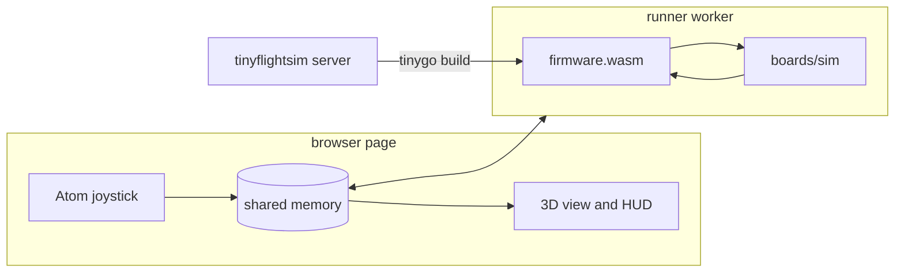

# Flying in the browser sim

`tools/tinyflightsim` flies the real Tinyflight firmware in a web browser. It builds `firmware/stampfly` with TinyGo to WebAssembly and runs it against a physics model of the StampFly. You fly it with an on-screen copy of the M5 Atom Joystick, the keyboard or a gamepad.


## Running it

You need Go and TinyGo. The sim build does not need the drivers checkout from the README.

```
cd tools/tinyflightsim
go run .
```

Then open http://localhost:8080.

The server builds the firmware the first time the page asks for it, which takes a few seconds. Builds are cached on a hash of the Go sources. After you change the firmware or a setting such as a gain in `boards/stampfly/config.go`, press **Restart** to rebuild and power cycle the drone.

| Flag | Default | What it does |
|---|---|---|
| `-addr` | `localhost:8080` | Address to serve on |
| `-repo` | `../..` | Root of the tinyflight module |
| `-tinygo` | `tinygo` | TinyGo command |
| `-firmware` | `./firmware/stampfly` | Firmware package to build |

To build with the newest TinyGo, run the server in the TinyGo dev container from the root of the repo. Git in the container does not trust the mounted checkout, so turn off VCS stamping:

```
docker run --rm -it -p 8080:8080 -e GOFLAGS=-buildvcs=false -v $(pwd):/src -w /src/tools/tinyflightsim tinygo/tinygo-dev:latest go run . -addr :8080
```

## Controls

The joystick works like the real one with the stock StampFlyController firmware. See [joystick.md](joystick.md) for the full details.

| Joystick | Keyboard | Gamepad | Setup screen | Running screen |
|---|---|---|---|---|
| Screen | Space | A | Go to the running screen | Arm or disarm |
| Left button | Q | LB | Toggle Stable and Sport | Back to setup, and disarm |
| Right button | E | RB | Toggle altitude mode Manual and Auto | Nothing |

| Stick | Keyboard | Gamepad |
|---|---|---|
| Left, throttle and yaw | W and S, A and D | Left stick |
| Right, pitch and roll | Arrow keys | Right stick |

Drag the sticks with the mouse or a finger. They spring back to centre when you let go, like the real joystick.

The keyboard throttle springs back in AltHold and PosHold. In Stabilize and Acro it stays where you leave it, since hovering with a spring loaded key is too hard. X centres it.

A first flight:

1. Wait for the LED on the drone to turn from blue to green. The gyro is calibrating.
2. Press Space to go to the running screen, and Space again to arm. The LED turns red.
3. Hold W to climb in AltHold. Let go and it holds the height.
4. Fly with the arrow keys. Hold S to come down. It disarms by itself 2 s after landing.

The **Camera** menu has a chase view, a pilot view from where you would stand, and an orbit view you can drag. The orange ring shows where the firmware thinks the drone is. **Pause** and **Speed** stop or slow down simulated time. **Console** shows what the firmware prints.

## How it works



- **The firmware.** `firmware/stampfly` builds for the sim with `-target=wasip1 -tags=tinyflightsim`. `board_sim.go` replaces the StampFly board, the radio and the two cores. Everything else is the code that flies the real drone: `pkg/`, `stampfly.Config()`, the Atom Joystick decoder and the telemetry encoder.
- **The simulated drone.** `boards/sim` wraps the `pkg/sim` physics in the `pkg/hal` interfaces. It turns body axes into the chip axes of the BMI270 and PMW3901, so the StampFly axis rotations work as they are. It clips the IMU at the ±16 g and ±2000 °/s the StampFly sets up. It also gives the model the small motor imbalance that `Rate.Trim` cancels on the real drone.
- **Timing.** The flight loop runs on simulated time at 400 Hz with 4 physics steps per pass, the same as the closed loop tests. Every 10 ms of simulated time it sleeps until the wall clock catches up.
- **The runner.** `web/runner.js` runs the wasm in a web worker. It comes from the [TinyGo playground](https://github.com/tinygo-org/playground) runner and provides the WASI calls TinyGo uses, plus three imports from `boards/sim/bridge.go`.

| Import | Direction | What it carries |
|---|---|---|
| `read_input` | page to firmware | The newest 25 byte joystick packet |
| `publish_state` | firmware to page | True and estimated position, attitude, motors, LED and status, about 66 times per second |
| `telemetry` | firmware to page | The 120 byte telemetry packet for the joystick screen, 20 times per second |

These go through a SharedArrayBuffer, because the firmware blocks the worker while it runs. The page needs cross origin isolation for that, so open it from the tinyflightsim server and not as a file.

## Limits

- The physics is the simple model from `pkg/sim`. There is no wind, ground effect or battery drain.
- Touching the ground snaps the drone level and stops it at once. After a hard landing the attitude and height estimates can take a few seconds to settle, because the IMU never sees the impact. Press **Restart** if a crash leaves it upside down.
- The serial bench input, the blackbox log and the front ToF sensor are not in the sim.
